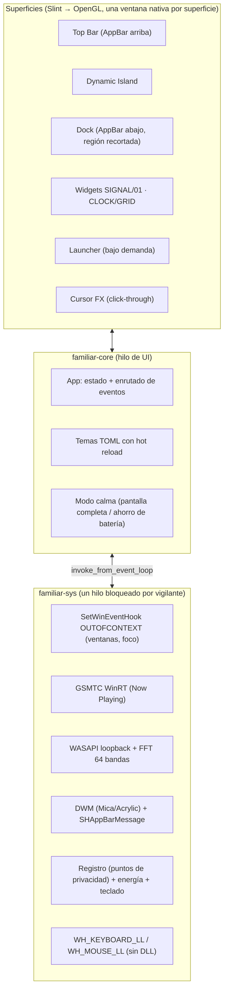

# Familiar Core

Clon nativo y ligero de [Familiar Desktop](https://familiardesktop.com) para
Windows 11: **Top Bar**, **Dynamic Island**, **Dock flotante con magnificación**,
**widgets dot-matrix** (SIGNAL/01, CLOCK/GRID), **launcher** y **temas en caliente**,
en un único binario Rust sin navegador embebido.

| Objetivo | Cómo se aborda |
|---|---|
| < 25 MB de RAM | Sin WebView2/Chromium: UI compilada con Slint (femtovg/OpenGL), un solo proceso, estado en SQLite con caché de 256 KiB. |
| 0 % de CPU en reposo | Todos los vigilantes bloquean en el kernel (`GetMessageW`, `WaitForMultipleObjects`, `RegNotifyChangeKeyValue`, `ReadDirectoryChangesW`). Los únicos temporizadores periódicos son el reloj (1 vez por minuto) y las animaciones, que se detienen solas. |
| $0, 100 % local | Ningún servicio de red. |

> **Estado:** el workspace compila y enlaza para `x86_64-pc-windows-gnu` y pasa
> `clippy` y 40 tests de los crates portables. La CI compila también con MSVC
> en `windows-latest`. Todavía no se ha ejecutado sobre un escritorio Windows
> real desde este repositorio, así que conviene probarlo primero con
> `hide_taskbar = false` (ver [Configuración](#configuración)).

## Arquitectura



| Crate | Plataforma | Contenido |
|---|---|---|
| `familiar-layout` | portable | Magnificación coseno del Dock, rejilla de widgets, detector de "agitar cursor". |
| `familiar-signal` | portable | Analizador FFT (Hann, 2048 puntos, 64 bandas log), matrices de puntos, fuente 5×7, cara de SIGNAL/01, rasterizador RGBA. |
| `familiar-theme` | portable | Modelo de tema, colores `#RRGGBBAA`, códigos para compartir `FAM1:…`, hot reload. |
| `familiar-store` | portable | SQLite: `dock_items`, `widget_layouts`, `app_index`; búsqueda difusa en memoria. |
| `familiar-sys` | Windows | AppBar, DWM, barra de tareas, hooks, privacidad, energía, apps instaladas, iconos 256 px, GSMTC, WASAPI, WorkerW, cursores, autoarranque. |
| `familiar-core` | Windows | Binario `familiar-core.exe`: UI Slint (`ui/*.slint`) y orquestación. |

### Cómo está implementada cada función

- **Top Bar sin tapar ventanas maximizadas**: se registra con
  `SHAppBarMessage(ABM_NEW / ABM_QUERYPOS / ABM_SETPOS)`; Windows reduce el área
  de trabajo. Responde a `ABN_POSCHANGED` y se vuelve a registrar si Explorer se
  reinicia (`TaskbarCreated`).
- **Dock**: los anclados vienen de SQLite y se emparejan con las ventanas abiertas
  por AppUserModelID o ruta del `.exe`. En reposo la ventana mide lo que la
  placa y esa franja se reserva como AppBar inferior; al pasar el ratón crece
  hacia arriba. La ventana se recorta con `SetWindowRgn` a placa + iconos +
  tooltip, de modo que el Acrylic toma esa forma y los clics fuera del Dock
  llegan a las ventanas de debajo.
  - Clic: abre o minimiza la app, o recorre sus ventanas si tiene varias. Clic
    central: abre una instancia nueva. Clic derecho: ancla o desancla.
- **Puntos de privacidad**: `RegNotifyChangeKeyValue` sobre
  `HKCU\…\CapabilityAccessManager\ConsentStore` (subárbol). Una app usa la
  cámara o el micrófono mientras su `LastUsedTimeStop == 0`; se recorren las
  apps empaquetadas y `NonPackaged`.
- **Dynamic Island**: `GlobalSystemMediaTransportControlsSessionManager` para
  título, artista, carátula y ⏮ ⏯ ⏭. La ventana mide lo que la píldora
  plegada y solo crece mientras está expandida.
- **SIGNAL/01 y visualizador**: captura WASAPI loopback por eventos (en silencio
  no llegan paquetes, así que el hilo no se despierta), FFT de 64 bandas en el
  hilo de captura y como máximo 30 fps hacia la UI. Cada frame se dibuja como
  **una** textura, no como cientos de elementos de UI.
- **Modo calma**: con `EVENT_SYSTEM_FOREGROUND` o `ABN_FULLSCREENAPP` se
  consulta `SHQueryUserNotificationState` (D3D a pantalla completa o modo
  presentación) y si la ventana cubre el monitor. En ese caso se ocultan todas
  las superficies y se detiene la captura de audio. Con el ahorro de batería
  activo también se pausa el audio.
- **Launcher**: se abre con un toque de la tecla Win. Un hook `WH_KEYBOARD_LL`
  inyecta la tecla neutra `0xE8` para que no se abra el menú Inicio. En modo
  calma los hooks de teclado y ratón se desinstalan, así que el juego no paga
  ninguna llamada por evento. Busca de
  forma difusa en el índice en memoria, que se construye desde `shell:AppsFolder`
  e incluye apps Win32 y de la Store. Esc, ↑/↓ e Intro funcionan como se espera.
- **Iconos nítidos**: `IShellItemImageFactory::GetImage` a 256×256, convertidos
  a alfa recta y guardados como PNG en `%LOCALAPPDATA%\FamiliarCore\cache\icons`.
- **Widgets sobre Wallpaper Engine**: por defecto quedan al fondo del orden Z.
  Con `widgets.attach_to_wallpaper = true` se cuelgan del `WorkerW` del fondo
  (incluida la disposición de Windows 11 24H2), es decir, por encima del fondo
  animado y por debajo de los iconos.
- **Cursor**: `SetSystemCursor` con los `.cur`/`.ani` del tema. Se restaura con
  `SPI_SETCURSORS`. La onda al hacer clic y el halo al agitar se dibujan en una
  ventana click-through.

### Robustez (riesgos del plan)

1. **Nunca te quedas sin barra de tareas**: se restaura al salir, en un panic
   hook, en `SetConsoleCtrlHandler` y en `WM_ENDSESSION`. **Ctrl+Alt+Q** es la
   salida de emergencia. Si el proceso muere de golpe, queda un archivo marcador
   y el siguiente arranque (o `familiar-core --restore-taskbar`) devuelve la
   barra a su estado original, incluido el auto-ocultar.
2. **Anti-cheat / antivirus**: no se inyecta ninguna DLL. Solo se usan
   `WINEVENT_OUTOFCONTEXT` y hooks de bajo nivel, que se ejecutan en nuestro
   propio proceso.
3. **Iconos en alta resolución**: ver arriba.

## Compilar

Requisitos: Rust estable ≥ 1.92 (edición 2024).

```powershell
# En Windows (MSVC)
cargo build --release -p familiar-core
.\target\release\familiar-core.exe
```

```bash
# Compilación cruzada desde Linux
sudo apt install gcc-mingw-w64-x86-64
rustup target add x86_64-pc-windows-gnu
cargo build --release -p familiar-core --target x86_64-pc-windows-gnu
```

Los tests de los crates portables corren en cualquier SO con `cargo test --workspace`.

El renderizador se elige con features:

| Feature | Renderizador |
|---|---|
| `renderer-femtovg` (por defecto) | OpenGL, el de menor huella. |
| `renderer-wgpu` | femtovg sobre WGPU (D3D12/Vulkan). |
| `renderer-skia` | Skia; mejor texto, binario más grande. |

Para medir el consumo: abre el Administrador de tareas → Detalles → columna
"Memoria (conjunto de trabajo privado)". Para ver el detalle por hilo usa
Process Explorer.

## Uso

| Acción | Atajo |
|---|---|
| Abrir/cerrar launcher | Toque de **Win** (o el atajo configurado), ◆ de la Top Bar |
| Salida de emergencia | **Ctrl+Alt+Q** |
| Mover un widget | Arrastrar; se ajusta a la rejilla al soltar |

```text
familiar-core --restore-taskbar     restaura la barra de Windows y sale
familiar-core --export-theme        imprime el tema activo como código FAM1:…
familiar-core --import-theme CODE   instala un tema compartido y lo activa
familiar-core --list-themes         lista los temas instalados
```

## Configuración

Los archivos están en `%APPDATA%\FamiliarCore\` (o en `FAMILIAR_HOME` para el
modo portable): `config.toml`, `themes\`, `familiar_state.db` y
`familiar-core.log`. Con `FAMILIAR_LOG=debug` se obtiene más detalle en el log.

```toml
theme = "ember-dark"        # o una ruta a un .toml
hide_taskbar = true         # pruébalo primero con false
autostart = false

[dock]
enabled = true
reserve_space = true        # las ventanas maximizadas acaban encima del Dock
show_running = true

[top_bar]
enabled = true
date_format = "ddd d MMM"   # sintaxis de GetDateFormatEx, en tu idioma

[island]
enabled = true

[widgets]
enabled = true
attach_to_wallpaper = false
items = ["signal_01", "clock_grid"]

[launcher]
hotkey = "win"              # o "alt+space", "ctrl+shift+k", ...
max_results = 8

[calm]
pause_on_fullscreen = true
pause_on_battery_saver = true
```

Los temas (`ember-dark`, `glacier-light`, `mono-signal`) se describen en
[`crates/familiar-theme/themes/README.md`](crates/familiar-theme/themes/README.md).
Al guardar el `.toml` activo, el cambio se aplica al instante.

## Plan de fases y estado

| Fase | Contenido | Estado |
|---|---|---|
| 1 | Workspace Rust + windows-rs + Slint; Dock transparente sin bordes con DWM; iconos 256 px; magnificación; lanzar procesos; WinEventHook con indicador de apps abiertas y activar al clic | ✅ |
| 2 | Top Bar como AppBar; reloj, idioma del teclado, batería, puntos de privacidad; Dynamic Island con GSMTC | ✅ |
| 3 | WASAPI loopback + FFT → SIGNAL/01 y visualizador; launcher con tecla Win y SQLite; WorkerW / Wallpaper Engine | ✅ |
| 4 | Temas TOML en caliente (colores, radios, materiales, cursores); detector de pantalla completa y batería | ✅ |

### Limitaciones conocidas y siguientes pasos

- Con `hide_taskbar = true` desaparece también el **área de notificación** (iconos de la bandeja del sistema). Alojar esos iconos requiere interceptar `Shell_NotifyIcon` y aún no está hecho. El menú Inicio sigue disponible con **Ctrl+Esc**.
- Solo usa el **monitor principal**; los monitores secundarios aún no tienen barra ni Dock.
- El Dock no permite **reordenar arrastrando** (el orden se guarda en `position_index`; falta la interacción).
- Los widgets de **pantalla de bloqueo** están previstos en el esquema (`target_screen = 'lockscreen'`), pero no implementados: Windows no permite dibujar sobre la pantalla de bloqueo desde una app de usuario.
- **Clima** y otros widgets que necesitan red quedan fuera por el requisito de "100 % local".
- El idioma del teclado se actualiza al cambiar de ventana y cada minuto, no al instante si lo cambias dentro de la misma ventana.

## Licencias de terceros

La UI usa [Slint](https://slint.dev) bajo su *Royalty-free Desktop License 2.0*,
que pide atribución (por ejemplo, un enlace "Hecho con Slint" en el README o en
la web del proyecto). Este repositorio aún no declara licencia propia; elige
una antes de distribuirlo.
